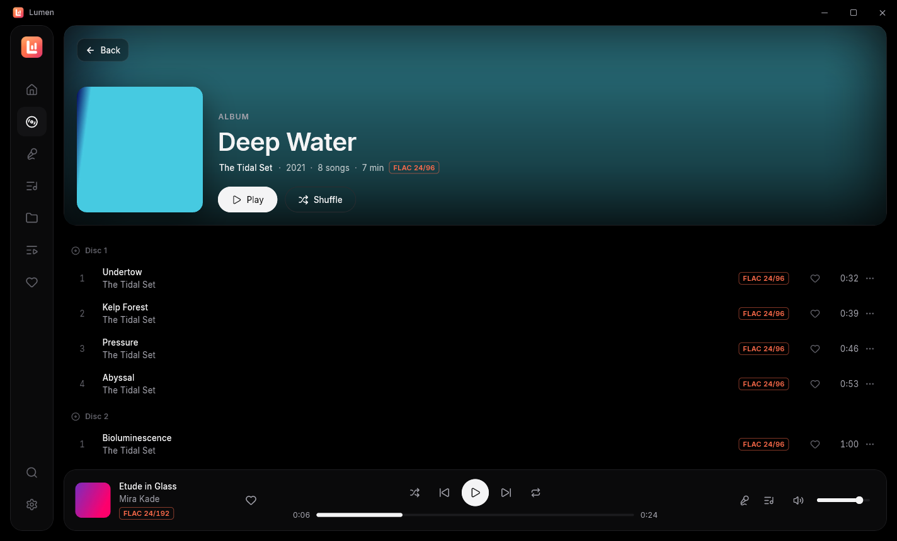
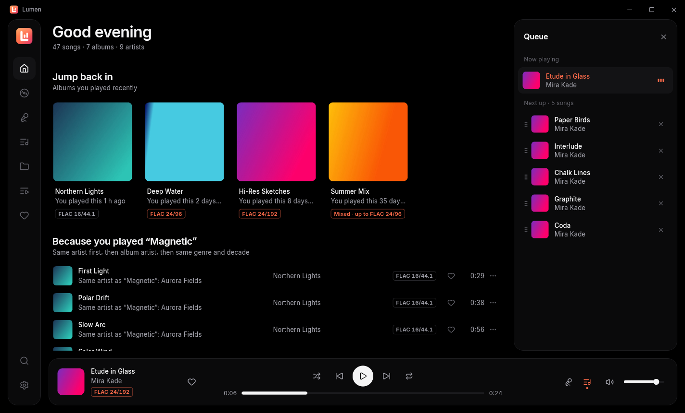
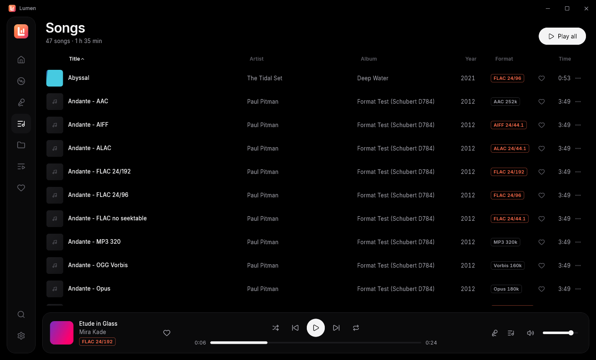
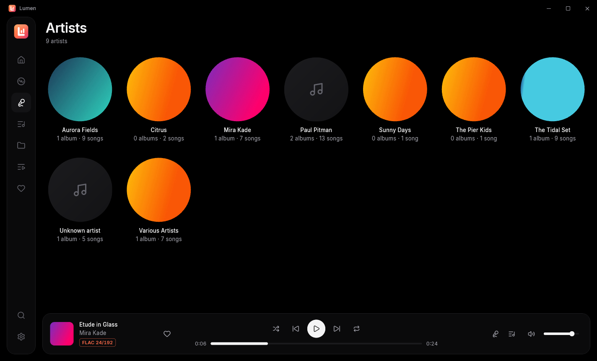
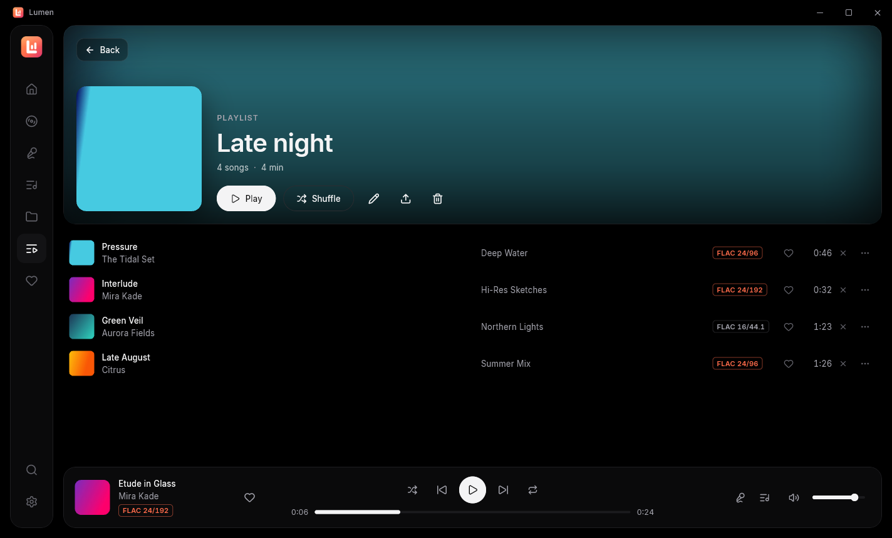

<div align="center">


# Lumen

**A beautiful, fast music player for your lossless library.**

Windows now · Android coming · No account, no internet, no AI. Just your music.

</div>

---


## Download

Get **[Lumen for Windows](https://github.com/capsuleutkarsh-design/lumen/releases/latest)** (beta): run `Lumen-Setup-….exe`, or unzip the portable `.zip` and run `lumen.exe`. Then open **Settings → Add folder** and pick your music folder. Lumen only reads your files; it never changes them.

> **Beta:** this is the first version. Please report anything odd in [Issues](https://github.com/capsuleutkarsh-design/lumen/issues).

## Screenshots

| | |
|---|---|
|  **Album** (a two-disc set) |  **Synced lyrics** |
|  **Ctrl+K search** |  **Play queue** |
|  **Songs**, with the quality of every file |  **Artists** |
|  **Playlist** | |

## Why Lumen

Lumen is inspired by [Wora](https://github.com/playwora/wora), a lovely-looking open-source player. It keeps that look and fixes what kept getting in the way:

| In Wora | In Lumen |
|---|---|
| Seeking in FLAC files doesn't work | Exact, instant seeking in every format, including high-res FLAC with no seek table |
| Next / Previous feel random | A real play queue: *Play next*, *Add to queue*, drag to reorder; Previous goes back to what you actually heard; shuffle never repeats until everything has played |
| Gaps between tracks | Gapless playback |
| The library is slow and hard to manage | Fast background scanning of several folders; only changed files are rescanned; albums, multi-disc sets and *Various Artists* grouped correctly |
| Suggestions miss | Suggestions from your own listening, each one telling you why: *Jump back in*, *Most played*, *Not played in a while*, *Recently added*, *Because you played…* |

## Features

- **Every common format:** FLAC (any resolution), ALAC, WAV, AIFF, WavPack, MP3, AAC, OGG and Opus.
- **Bit-perfect output:** WASAPI exclusive mode and an output device picker, plus a quality badge such as *FLAC 24/96*.
- **Library:** albums, artists, songs, folders, playlists and favourites; M3U8 import and export.
- **Quick play:** press **Ctrl+K** to search songs, albums and artists.
- **Lyrics:** synced lyrics from `.lrc` files or embedded tags.
- **Windows integration:** media keys, the Windows media overlay, and your queue remembered after a restart.
- **Private:** everything stays on your PC.

## Build from source

You need [Flutter](https://flutter.dev) (stable) and Visual Studio 2022 with *Desktop development with C++*.

```bash
flutter pub get
flutter run -d windows
```

To build a release, run `flutter build windows --release`; the program is then in `build\windows\x64\runner\Release\`. To build the installer as well (needs [Inno Setup 6](https://jrsoftware.org/isinfo.php)), run `installer\build_installer.ps1`.

How v1 was built and tested: [docs/DONE_v1.md](docs/DONE_v1.md) · The plan: [docs/PLAN.md](docs/PLAN.md)

## Licence

Lumen is free to use and share, made by **Utkarsh Tripathi**. It is not for sale. If you change it, keep the name with *"(modified by …)"*, keep the credits, and send your changes back as a pull request. Read the full [UT Community Licence 2.0](LICENSE.md).

Third-party parts and their licences are listed in [THIRD_PARTY_NOTICES.md](THIRD_PARTY_NOTICES.md).

Questions and bug reports: [open an issue](https://github.com/capsuleutkarsh-design/lumen/issues) or email [capsuleutkarsh@gmail.com](mailto:capsuleutkarsh@gmail.com).
