<div align="center">


# Lumen

**A beautiful, fast music player for your lossless library.**

Windows now · Android coming · No account, no internet, no AI. Just your music.

</div>

---

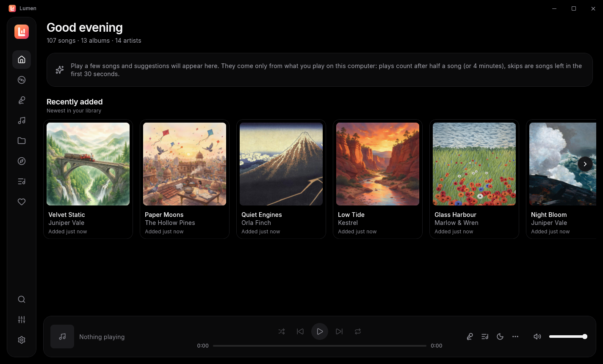

## Download

Get **[Lumen for Windows](https://github.com/capsuleutkarsh-design/lumen/releases/latest)** (beta): run `Lumen-Setup-….exe`, or unzip the portable `.zip` and run `lumen.exe`. Then open **Settings → Add folder** and pick your music folder. Lumen only reads your files; it never changes them.

> **Beta:** please report anything odd in [Issues](https://github.com/capsuleutkarsh-design/lumen/issues). What's new in 0.2.0: [release notes](docs/releases/v0.2.0.md).

## Screenshots

| | |
|---|---|
| 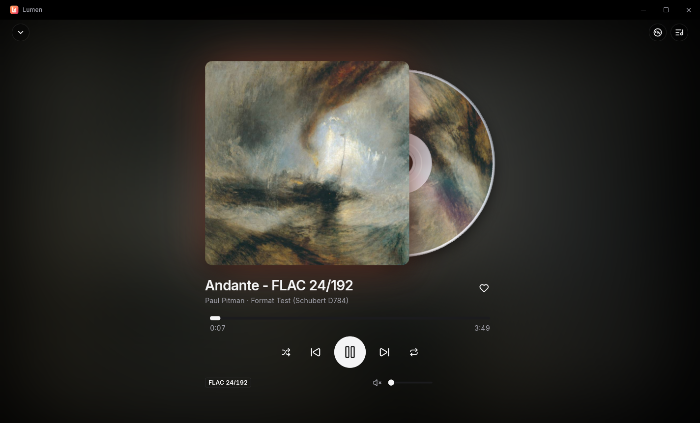 **Now Playing** with the spinning CD | 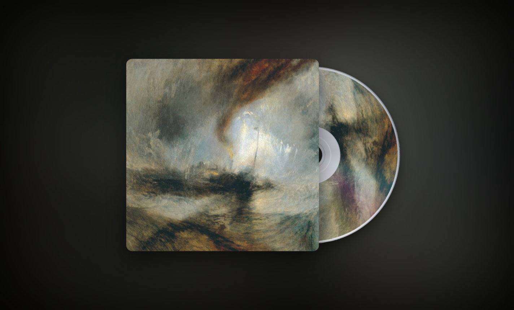 **Disc mode** (press D) |
| 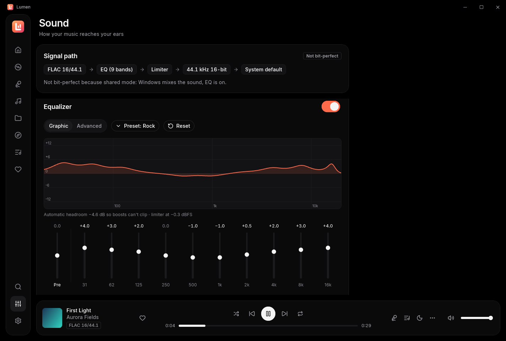 **Sound:** graphic EQ and the signal path | 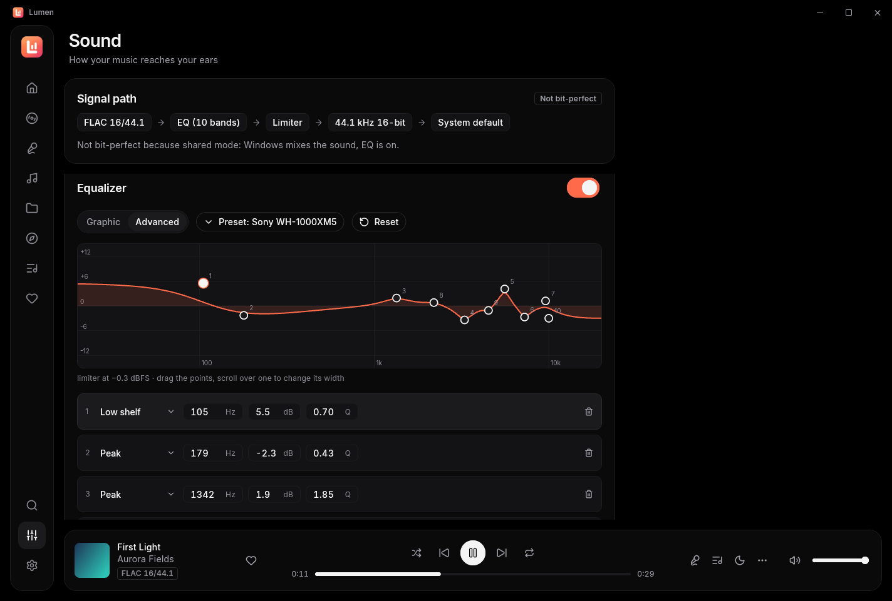 **Advanced EQ** with headphone correction |
| 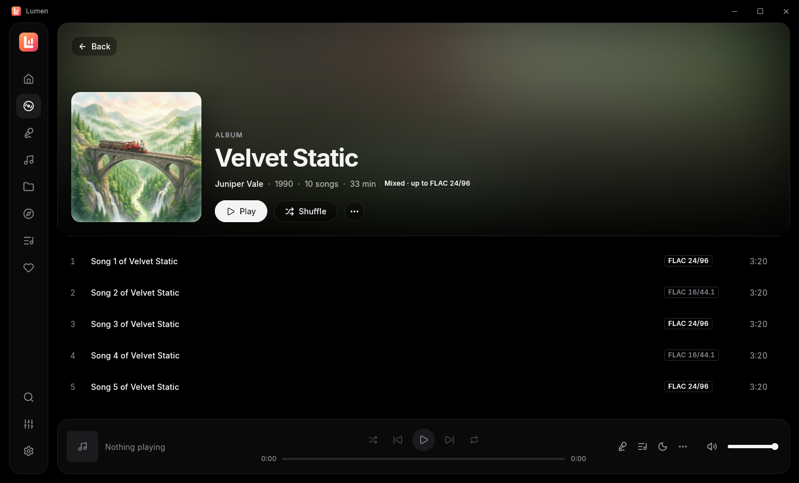 **Album** | 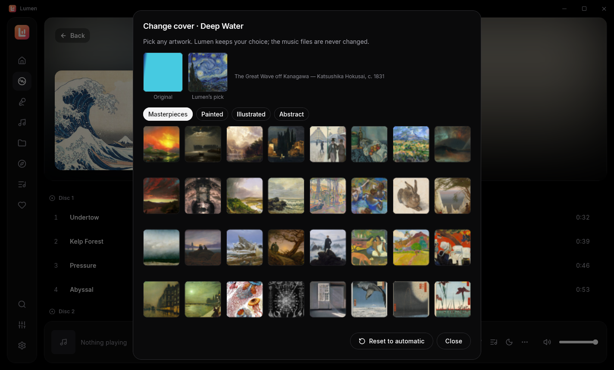 **Change cover**, with credits |
| 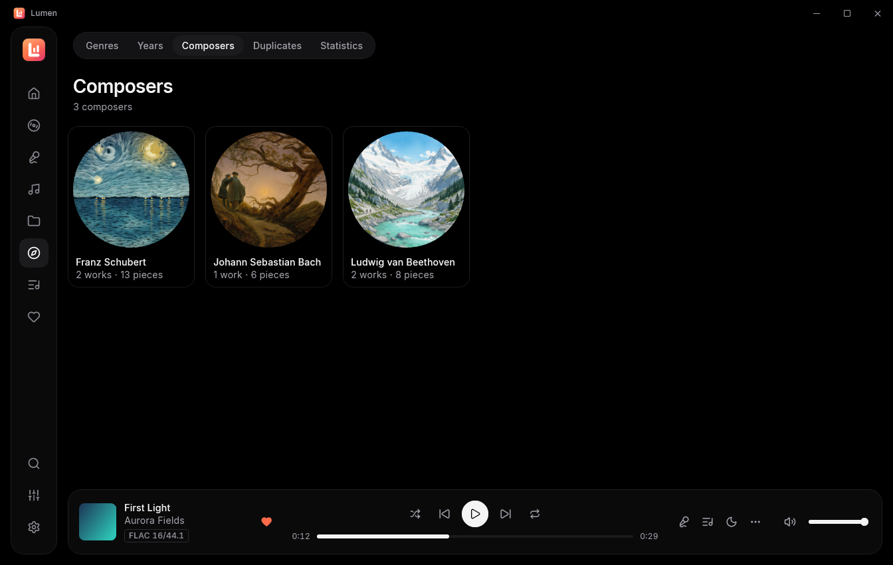 **Browse → Composers** | 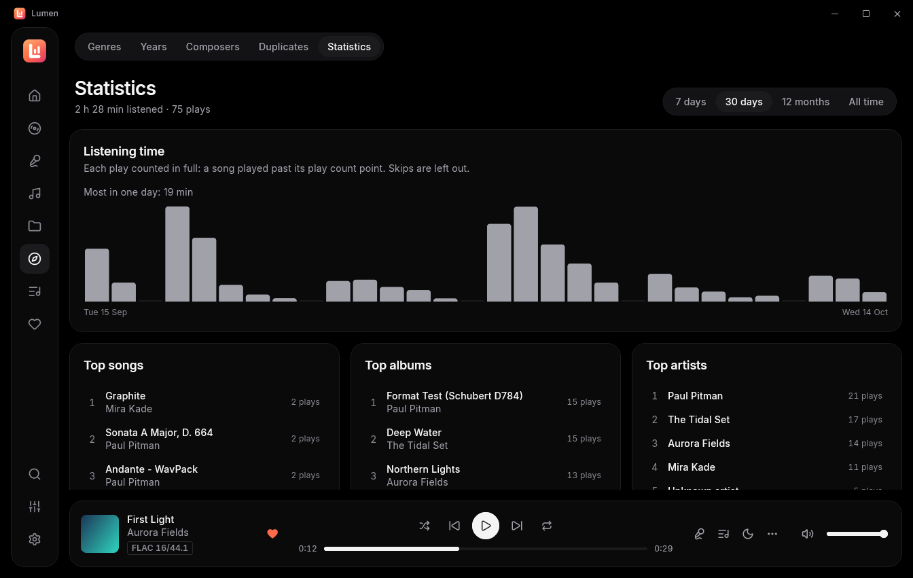 **Statistics** |
| 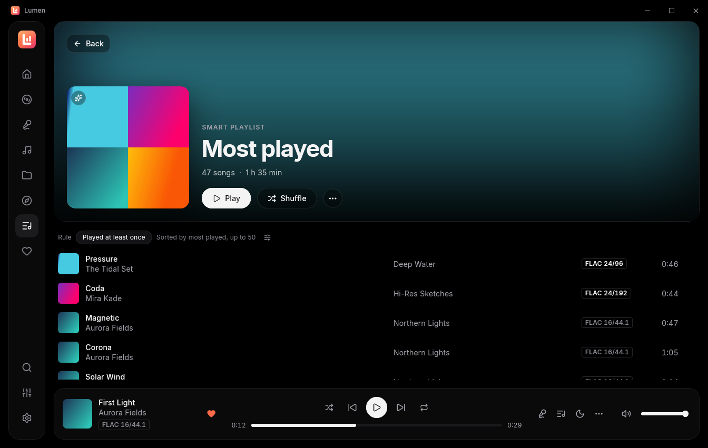 **Smart playlists** | 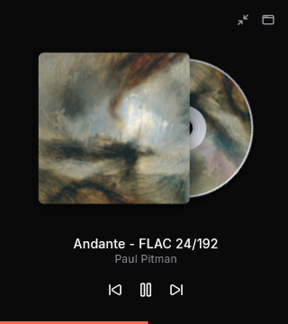 **Mini player** |
| 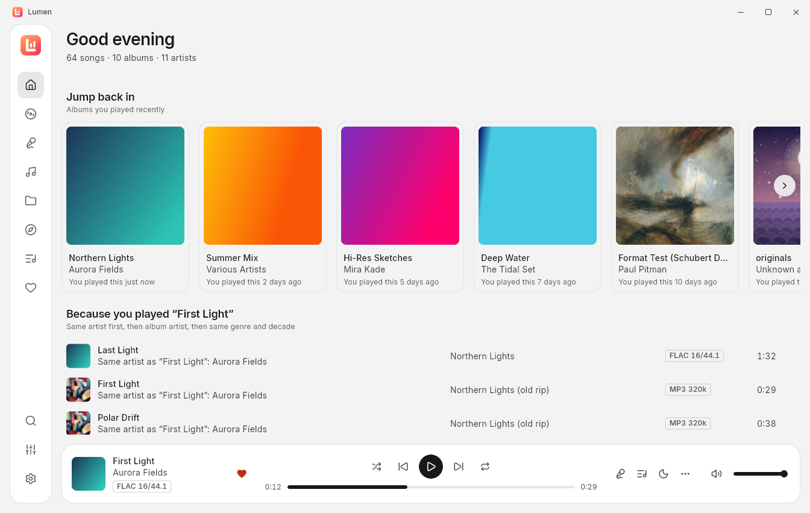 **Light theme** | 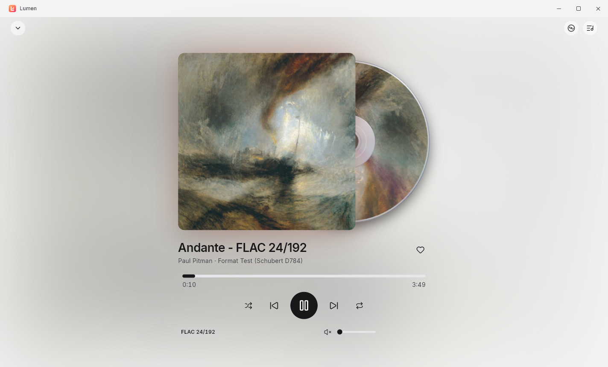 **Light theme:** Now Playing |
| 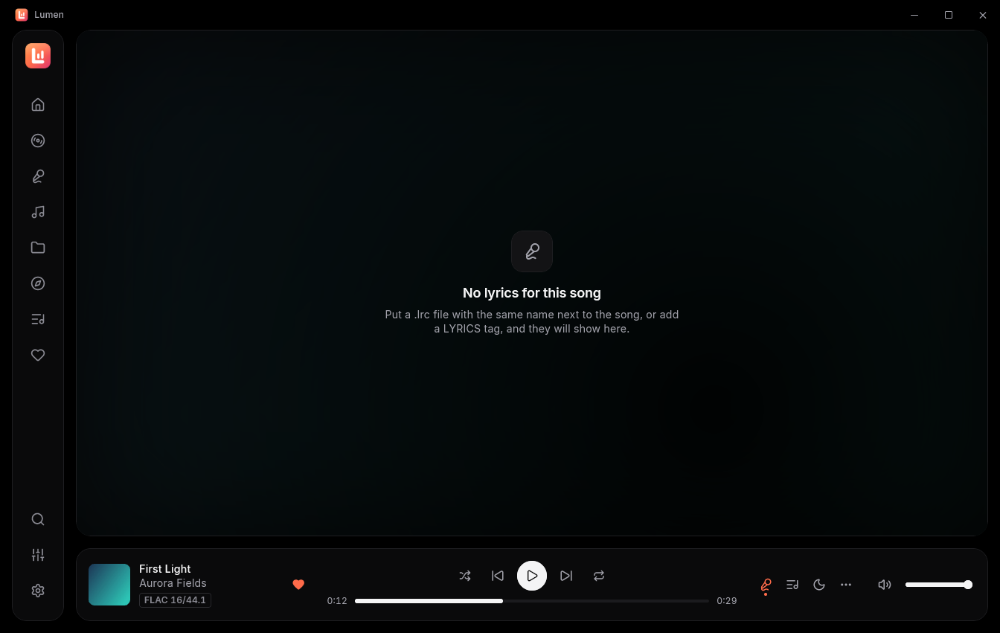 **Synced lyrics** | 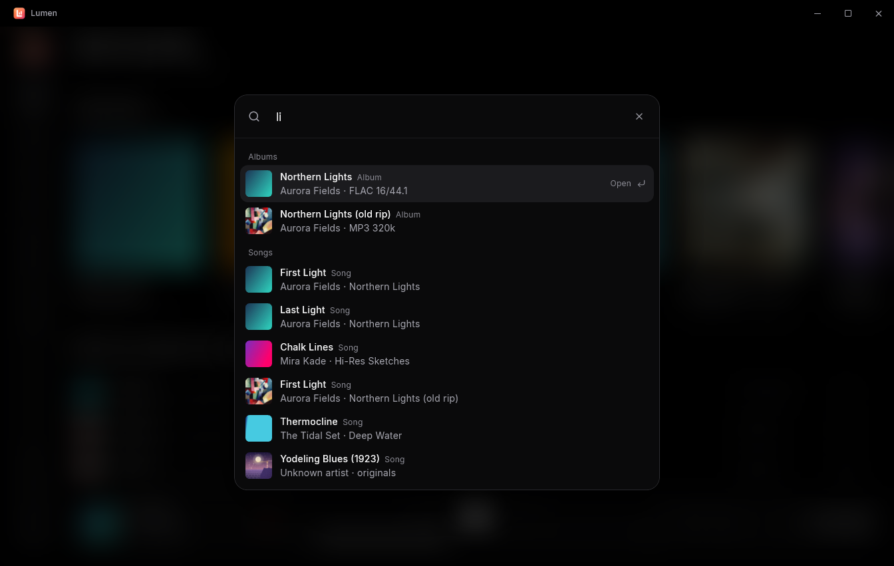 **Ctrl+K search** |

## Why Lumen

Lumen is inspired by [Wora](https://github.com/playwora/wora), a lovely-looking open-source player. It keeps that look and fixes what kept getting in the way:

| In Wora | In Lumen |
|---|---|
| Seeking in FLAC files doesn't work | Exact, instant seeking in every format, including high-res FLAC with no seek table |
| Next / Previous feel random | A real play queue: *Play next*, *Add to queue*, drag to reorder; Previous goes back to what you actually heard; shuffle never repeats until everything has played |
| Gaps between tracks | Gapless playback |
| The library is slow and hard to manage | Fast background scanning of several folders; only changed files are rescanned; albums, multi-disc sets and *Various Artists* grouped correctly |
| Suggestions miss | Suggestions from your own listening, each one telling you why: *Jump back in*, *Most played*, *Not played in a while*, *Recently added*, *Because you played…* |

## Features

- **Every common format:** FLAC (any resolution), ALAC, WAV, AIFF, WavPack, APE, DSD, MP3, AAC, OGG and Opus.
- **The Sound page:** a signal path that shows what happens to your music, with a verified **Bit-perfect** badge; a 10-band graphic and an advanced parametric **EQ** with presets; headphone correction from AutoEQ or Equalizer APO files; EQ per output device; crossfeed; upsampling with soxr; ReplayGain; and *Best quality on this device* (high-quality resampling, dither, headroom and a limiter, so even cheap speakers play cleanly).
- **Bit-perfect output:** WASAPI exclusive mode and an output device picker, plus a quality badge such as *FLAC 24/96*.
- **Cover art collections:** albums without a good cover get a public-domain painting (*Masterpieces*), a storybook illustration made for Lumen (*Illustrated*) or a style Lumen paints itself (*Painted*). Right-click → **Change cover** to pick any artwork, with credits. Your files are never changed.
- **The spinning disc:** a CD (or vinyl) slides out from behind the cover in Now Playing and turns while the music plays. **Disc mode** shows only the cover and the disc; the **mini player** keeps them in a small always-on-top window.
- **Library:** albums, artists, songs, folders, playlists and favourites; M3U8 import and export. **Browse** by genre, year and composer (works and their movements in order), and find duplicates.
- **Smart playlists** that update themselves (recently added, most played, never played, Hi-Res, or your own rules), and **Statistics** of your listening.
- **Quick play:** press **Ctrl+K** to search songs, albums and artists.
- **Lyrics:** synced lyrics from `.lrc` files or embedded tags.
- **Dark and light themes**, or follow Windows; the accent follows the album art.
- **Windows integration:** media keys, the Windows media overlay, a tray icon (with close to tray), a sleep timer, and your queue remembered after a restart.
- **Private:** everything stays on your PC. The only internet use is an optional update check, off unless you turn it on in Settings.

## Your data

Lumen keeps its library list, playlists, favourites, play counts, sound settings and a log (`lumen.log`) in **`%APPDATA%\Utkarsh Tripathi\Lumen\`**. *Settings → Data and updates* has buttons that open the folder and the log. Your music files are only read, never changed.

- **Caches:** cover thumbnails and the cover art Lumen draws are kept in `%LOCALAPPDATA%` (the art is capped at about 300 MB; the least recently used goes first). Deleting them is safe.
- **Portable copy:** the portable `.zip` has a `portable.txt` next to `lumen.exe`, so it keeps everything in a `userdata` folder beside the program instead. Delete `portable.txt` to use `%APPDATA%` again.
- **Uninstalling** asks whether to delete this data too; the answer is *keep* unless you choose otherwise.
- **If Lumen cannot start,** it shows why, with *Open data folder* and *Start fresh*. Start fresh renames the old library to `library.db.broken-<date>` and starts empty; nothing is deleted.

## Build from source

**The easy way:** double-click **`RUN.bat`** to try the app from the code, or **`BUILD.bat`** to check the code and make the program, the installer, the portable zip and `SHA256SUMS.txt` in `build\installer\` (it opens the folder when it is done). The version comes from `pubspec.yaml` only.

You need [Flutter](https://flutter.dev) (stable) and Visual Studio 2022 with *Desktop development with C++*.

```bash
flutter pub get
flutter run -d windows
```

To build a release, run `flutter build windows --release`; the program is then in `build\windows\x64\runner\Release\`. To build the installer and the zip as well (needs [Inno Setup 6](https://jrsoftware.org/isinfo.php)), run `installer\build_installer.ps1`. Pushing a `v*` tag makes GitHub Actions build them and draft a pre-release (`.github/workflows/ci.yml`).

How v1 was built and tested: [docs/DONE_v1.md](docs/DONE_v1.md) · The plan: [docs/PLAN.md](docs/PLAN.md)

## Licence

Lumen is free to use and share, made by **Utkarsh Tripathi**. It is not for sale. If you change it, keep the name with *"(modified by …)"*, keep the credits, and send your changes back as a pull request. Read the full [UT Community Licence 2.0](LICENSE.md).

Third-party parts and their licences are listed in [THIRD_PARTY_NOTICES.md](THIRD_PARTY_NOTICES.md).

Questions and bug reports: [open an issue](https://github.com/capsuleutkarsh-design/lumen/issues) or email [capsuleutkarsh@gmail.com](mailto:capsuleutkarsh@gmail.com).
