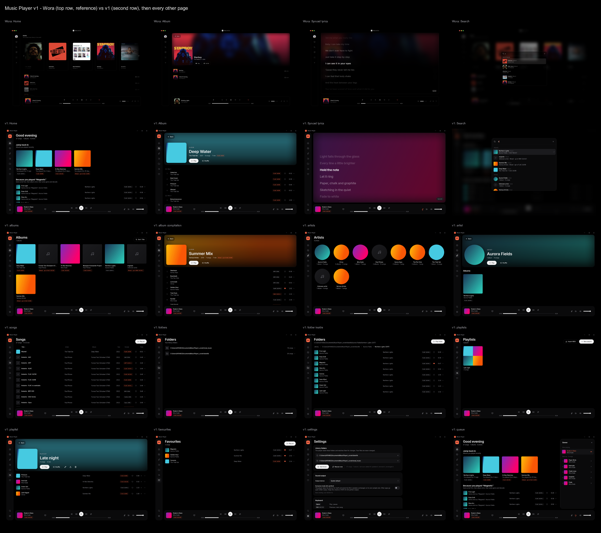

# Music Player: version 1 is built

A Windows music player for a lossless library, with Wora's look, and with the four things that were broken in Wora fixed. No AI anywhere, and nothing goes to the internet.

*Top row: Wora. Second row: the same four screens in version 1. Below: every other page.* Full-size pictures of each page are in `_scratch\shots\` (`01_home.png` … `15_search.png`).

## How to run it

- **The app:** `build\windows\x64\runner\Release\music_player.exe`. To move it somewhere else, copy the whole `Release` folder (the `.dll` files and the `data` folder must stay next to the `.exe`).
- **First start:** open **Settings → Add folder** and choose your music folder. You can add more than one. The library fills in while you watch; you can play music straight away.
- **Your data** (library database, play counts, playlists, cover thumbnails) lives in `%APPDATA%\com.example\music_player\`. Your music files are only read, never changed.

### Keys

| Key | Does |
|---|---|
| Space | Play / pause |
| Ctrl + ← / → | Previous / next song |
| ← / → | Back / forward 5 seconds |
| Ctrl + K | Search |
| Ctrl + L | Lyrics |
| Esc | Back |
| Media keys, and the Windows media overlay | Play, pause, next, previous |

## What's built

- **The look.** Pure black, thin dark-grey rounded panels, a slim icon rail on the left, a big rounded player bar (cover, title, artist, format badge, heart, transport, seek bar with times, lyrics, queue, volume). Album and artist pages have the blurred cover-colour header with **Play** (the one bright button) and **Shuffle**. The Ctrl+K search sits on a blurred backdrop. Lyrics are big, with the current line bright.
- **Improved, Juxtopposed-style.** Everything sits on a 4/8 px grid; a small set of text sizes; one accent colour (coral) used only for "playing", "on" and hi-res badges; panels slightly lighter than the background; inner corners smaller than outer corners; one main button per page; every button has hover, pressed, keyboard-focus and disabled looks; empty pages say what to do next; animations are 120–180 ms.
- **Font:** Inter (open font licence), credited in `THIRD_PARTY_NOTICES.md`.
- **Pages:** Home, Albums (sortable), Album, Artists, Artist, Songs (a table you sort by clicking the column titles), Folders (browse your folders), Playlists, Favourites, Settings.
- **Frameless window** with its own title bar (drag to move, minimise, maximise, close). It remembers its size and position.
- **Remembers the queue** and where you were in the song when you close the app.
- **Output device picker** and **exclusive (bit-perfect) mode** in Settings. Settings also shows what is actually being sent to the device, for example "s32 192000 Hz".

## How each Wora problem was fixed

### 1. Seeking in FLAC

Wora played through the browser's audio player, which can't jump inside many FLAC files. This player uses **libmpv** (the engine of the mpv player). It reads the file itself and jumps to the exact sample, with or without a seek table.

**Tested** on every file in both test folders: play, jump to 80 %, check where it landed, then play on for 1 second and check the clock is still right.

| Format | Plays | Lands within 0.2 s | Clock right 1 s later | Duration right | Tags read | Cover |
|---|---|---|---|---|---|---|
| FLAC 16/44.1, with and without seek table | yes | yes (±0.000 s) | yes | yes | yes | yes (embedded and folder.jpg) |
| FLAC 24/96, with seek table | yes | yes | yes | yes | yes | yes (cover.jpg in the album folder) |
| **FLAC 24/192, no seek table** | yes | yes | yes | yes | yes | yes (embedded) |
| FLAC 24/44.1 "streamed", no seek table and no length in the header | yes | yes | yes | yes (worked out from the last frame) | yes | none in file |
| ALAC (.m4a), 16 and 24 bit | yes | yes | yes | yes | yes | yes (embedded) |
| AAC (.m4a) | yes | yes | yes | yes | yes | none in file |
| MP3 (256k, 320k, VBR) | yes | yes | yes | yes | yes | yes (embedded) |
| WAV 24-bit | yes | yes | yes | yes | yes (title/artist/album; WAV can't hold album artist) | from folder.jpg |
| AIFF 24-bit | yes | yes | yes | yes | yes | none in file |
| OGG Vorbis | yes | yes | yes | yes | yes | none in file |
| Opus | yes | yes | yes | yes | yes | none in file |
| WavPack | yes | yes | yes | yes | yes | none in file |
| WebM (Opus and Vorbis) from Wikimedia | yes | yes | yes | yes | title only: the files carry no artist or album | none in file |

Every jump finished in under 10 ms. "None in file" means that test file simply has no picture; the album then shows a quiet placeholder. Two downloaded MP3s are titled "tmp" because that is what their own tags say.

### 2. Next and Previous

Wora just moved a number up and down a list. This player has a **real queue**:

- **Play now** (double-click any song: the list it's in plays from there), **Play next**, **Add to queue** (right-click any song, or the ••• button).
- The **queue panel** (button in the player bar) shows what's playing and what's next. Drag to reorder; × to remove; double-click to jump.
- **Previous:** more than 3 seconds into a song, it starts the song again. Otherwise it goes back to the song you actually heard before (even after a jump or with shuffle on).
- **Shuffle** plays every song once before any song repeats (also when it starts over with Repeat all). Turning shuffle **off** puts the list back in its original order, at the song that is playing.
- **Repeat** off / all / one.
- **Gapless.** The next song is loaded before the current one ends, so live albums and DJ mixes flow without a click or pause. Tested:

| Change | Format | Gap | Sound output reopened |
|---|---|---|---|
| Etude in Glass → Paper Birds | FLAC 24/192 | 0 ms | no |
| Abyssal (CD 1) → Bioluminescence (CD 2) | FLAC 24/96 | 0 ms | no |
| Schubert D 664: Andante → Allegro (real recording) | FLAC 24/44.1 | 0 ms | no |
| Op. 65: Scherzo → Largo (real recording) | MP3 | −47 ms (the MP3's built-in padding is skipped, as it should be) | no |

When two songs have different formats (say 44.1 kHz then 96 kHz), the player re-opens the output at the new rate instead of converting it, so what reaches your DAC stays untouched.

### 3. Library and its management

- **One or more folders**, chosen in Settings.
- **Scanning happens in the background** (a separate worker), so the app never freezes. Progress shows at the top right ("Scanning 12 / 30") and in Settings.
- **Rescans only read new or changed files** (by date and size) and remove files that are gone. If a folder is missing, for example an unplugged drive, its songs (and their play counts) are kept until it comes back.
- **Watches your folders** while the app is open: add, change or delete a file and the library follows within a few seconds.
- **Albums** are grouped by album artist + album, so CD1/CD2 folders become one album with disc headings. Compilations become "Various Artists" (from the compilation flag, from the album artist tag, or because a folder's album has several artists). A song that lacks the album artist tag joins the rest of its album.
- **Format badge** on every song and album: FLAC 24/96, ALAC 16/44.1, MP3 320k… Hi-res badges are in the accent colour.
- **Cover art** from the picture inside the file, or `cover.jpg` / `folder.jpg` / `front.jpg` in the folder (or the album folder above CD1/CD2). Each picture is shrunk once into a small cached copy, so lists stay fast.
- The **tag reader** is written for this app (no extra tools needed). The ready-made one tried first read MP3 album artists as artists and missed album artist and compilation in .m4a files, which is exactly what breaks album grouping.

### 4. Suggestions

Only from what you play on this computer:

- A song counts as **played** after you have actually listened to half of it, or 4 minutes. Leaving a song in its first 30 seconds counts as a **skip**. Jumping forward doesn't count as listening.
- **Home** shows: **Jump back in** (albums you played lately), **Because you played "X"** (same artist first, then same album artist, then same genre and decade; leaves out songs you played in the last 2 days and songs you often skip), **Most played**, **Not played in a while** (played at least 3 times, but not in the last 30 days), **Recently added**.
- **Hover any suggestion to see why** it's there ("Played 4 times, last 2 months ago").

## Also in version 1

- **Playlists:** create, rename, add (right-click → Add to playlist), drag to reorder, remove, delete; import and export M3U8.
- **Favourites:** the heart, in every list and in the player bar.
- **Search (Ctrl+K):** songs, albums and artists with covers; ↑ ↓ to move, Enter to open, Esc to close.
- **Lyrics (Ctrl+L):** a `.lrc` file with the same name next to the song (synced: the line follows the music, click a line to jump there), or the LYRICS tag inside the file (shown as plain text if it has no timings).
- **Volume and mute.**
- **Windows media overlay and media keys.** Checked by asking Windows: it shows the song's title, artist, album and cover, and pressing play/pause there plays and pauses the app.

## How it was checked

- **Unit tests** (`flutter test`, 19 tests): the queue (shuffle without repeats, Previous rule, Play next, repeat modes, shuffle off), the suggestion rules and the play/skip rule, the scanner's incremental rescan (including an unplugged folder), album grouping, LRC lyrics and M3U8.
- **End-to-end test** (`integration_test\app_test.dart`): starts the real app with a separate test data folder at volume 0, scans both test folders, runs the seek and gapless checks above, then takes the screenshots.
- `flutter analyze`: no issues. `flutter build windows --release`: builds.
- **Test music:** `_scratch\testlib` (made with `tool\make_testlib.ps1`: 4 albums, 29 songs, FLAC 16/44.1, 24/96 and 24/192 with and without seek tables, MP3, ALAC, WAV, covers, a 2-disc album, a compilation, an .lrc) and `_scratch\real_music` (Wikimedia Commons recordings and copies in 10 formats). Your own music folders were never read.

## Good to know

- **Exclusive mode** makes the player take the sound device for itself: other apps go quiet while it plays. For a truly bit-perfect signal keep the player's volume at 100 % and set the volume on your DAC or amplifier. The switch and the device picker work through mpv; they were not flipped during testing so your PC's sound wasn't taken over.
- The **release app was built but not opened here**, because opening it would create its data folder in your own AppData. The same code was run as a test build pointed at the test data folder.
- Songs with no tags at all show the file name as the title and are grouped by their folder name.
- The working name is "Music Player" with a placeholder icon and package name (`com.example`); rename when you pick a name.

## For a developer building it

`flutter build windows --release`. Without Windows Developer Mode, `flutter pub get` may stop with "requires symlink support"; then run `powershell -ExecutionPolicy Bypass -File tool\link_plugins.ps1` once (it links the plugins with folder junctions, which need no special rights) and build again.

End-to-end test: `flutter test integration_test -d windows --dart-define=MP_DATA=<project>\_scratch\appdata --dart-define=MP_ROOT=<project>`. Contact sheet: `dart run tool/contact_sheet.dart`.

## Left for version 2

- Tag editor; find duplicates and missing files.
- ReplayGain (track/album), equaliser, optional crossfade, `.cue` sheets.
- Smart playlists (rules), listening statistics, "forgotten favourites" and time-of-day suggestions.
- Mini player, light theme, a real name and icon.
- Multi-select in lists (select several songs, then Play next / Add to playlist).
- Fetching cover art for albums that have none (it would need the internet, so only if you want it).
- Android, from the same code (the Windows-only parts are kept in `lib/platform` and `windows/runner`).
